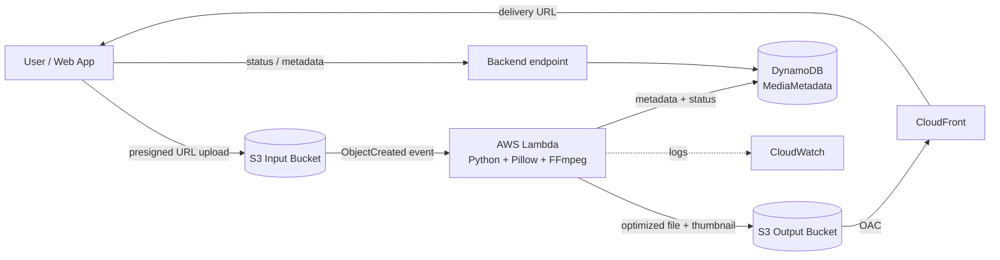

# AWS Serverless Media Transcoder and Thumbnail Pipeline

A serverless AWS system that automatically processes uploaded images and videos, creates optimized versions and thumbnails, stores metadata, and delivers the results through CloudFront.

> **Status:** 🚧 In development. Image pipeline first, video support afterwards.

---

## Table of Contents

1. [Overview](#overview)
2. [Architecture](#architecture)
3. [Tech Stack](#tech-stack)
4. [Repository Structure](#repository-structure)
5. [Team and Responsibilities](#team-and-responsibilities)
6. [Shared Contracts (Agree Before Coding)](#shared-contracts-agree-before-coding)
7. [Implementation Roadmap](#implementation-roadmap)
8. [Getting Started](#getting-started)
9. [Testing](#testing)
10. [Measuring Results](#measuring-results)
11. [Timeline](#timeline)
12. [Common Mistakes to Avoid](#common-mistakes-to-avoid)
13. [Deliverables Checklist](#deliverables-checklist)
14. [Cost and Cleanup](#cost-and-cleanup)

---

## Overview

When a user uploads a file (for example, a 4 MB `photo.jpg`):

1. The website uploads it to the **input S3 bucket** using a presigned URL.
2. S3 fires an `ObjectCreated` event that triggers **AWS Lambda**.
3. Lambda resizes and compresses the image (Pillow) and generates a thumbnail.
4. Optimized files are written to the **output S3 bucket**.
5. **DynamoDB** stores original size, optimized size, percentage saved and status.
6. **CloudFront** serves the processed files.
7. The website shows the processed image and its details.

For videos the workflow is the same, producing a compressed video and a thumbnail extracted from a frame (FFmpeg). Video needs more memory and execution time, so it is built **after** the image workflow works.

---

## Architecture



**Why two buckets?** Writing outputs to the same bucket that triggers Lambda can cause Lambda to retrigger itself. Separate input and output buckets prevent this.

---

## Tech Stack

| Layer | Technology |
|---|---|
| Storage | Amazon S3 (input and output buckets) |
| Compute | AWS Lambda (Python) |
| Image processing | Pillow |
| Video processing | FFmpeg (Lambda layer or container image) |
| Database | Amazon DynamoDB |
| Delivery | Amazon CloudFront with Origin Access Control (OAC) |
| Security | IAM roles, presigned URLs, Block Public Access |
| Monitoring | Amazon CloudWatch |
| Frontend | HTML, CSS, JavaScript |

---

## Repository Structure

```
aws-media-pipeline/
├── frontend/
│   ├── index.html
│   ├── style.css
│   └── app.js
├── backend/
│   ├── lambda_function.py
│   ├── image_processor.py
│   ├── video_processor.py
│   └── requirements.txt
├── infrastructure/
│   ├── architecture.md
│   └── deployment-notes.md
├── tests/
│   ├── test_images/
│   └── test_videos/
├── README.md
└── .gitignore
```

---

## Team and Responsibilities

| Member | Role | Main folders | Responsibilities |
|---|---|---|---|
| **Person 1** (Name: _TBD_) | Infrastructure lead and final integration | `infrastructure/` | S3 buckets, event triggers, IAM roles, CloudFront + OAC, deployment and integration |
| **Person 2** (Name: _TBD_) | Processing lead | `backend/` | Lambda handler, Pillow image processing, thumbnails, FFmpeg video processing, error handling |
| **Person 3** (Name: _TBD_) | Application lead | `frontend/` | Upload UI, presigned URL flow, DynamoDB schema, status and results page |

**Git workflow**

- Branches: `feature/aws-setup`, `feature/media-processing`, `feature/frontend`
- Merge working features into `main` through pull requests.
- Avoid several people editing the same file at the same time.

---

## Shared Contracts (Agree Before Coding)

Fill these in as a team and keep them updated. Mismatched names here are the most common cause of integration problems.

### Resources

| Item | Value |
|---|---|
| AWS Region | `<your-region>` |
| Input bucket | `<your-project>-input-<unique>` |
| Output bucket | `<your-project>-output-<unique>` |
| DynamoDB table | `MediaMetadata` |
| CloudFront domain | `<distribution-id>.cloudfront.net` |

### S3 key naming

Use unique keys based on `mediaId` so files are never overwritten and retries are safe.

| Purpose | Bucket | Key pattern |
|---|---|---|
| Original upload | Input | `uploads/{mediaId}/{originalName}` |
| Optimized image | Output | `processed/{mediaId}.webp` |
| Optimized video | Output | `processed/{mediaId}.mp4` |
| Thumbnail | Output | `thumbnails/{mediaId}.jpg` |

### DynamoDB record (`MediaMetadata`)

Partition key: `mediaId` (String)

```json
{
  "mediaId": "photo-001",
  "originalName": "photo.jpg",
  "mediaType": "image",
  "originalSizeBytes": 4000000,
  "optimizedSizeBytes": 950000,
  "reductionPercent": 76.25,
  "status": "COMPLETED",
  "outputKey": "processed/photo-001.webp",
  "thumbnailKey": "thumbnails/photo-001.jpg",
  "processingTimeMs": 0,
  "errorMessage": null,
  "createdAt": "2026-01-01T00:00:00Z"
}
```

> Values above are illustrative examples, not measured results.

`status` values: `UPLOADED` → `PROCESSING` → `COMPLETED` or `FAILED`

### Lambda environment variables

| Variable | Description | Example |
|---|---|---|
| `OUTPUT_BUCKET` | Output bucket name | `my-project-output-xyz` |
| `TABLE_NAME` | DynamoDB table | `MediaMetadata` |
| `CLOUDFRONT_DOMAIN` | CloudFront domain for URLs | `dxxxx.cloudfront.net` |
| `MAX_IMAGE_WIDTH` | Max resized width in px | `1920` |
| `THUMBNAIL_SIZE` | Thumbnail size in px | `200` |
| `WEBP_QUALITY` | WebP compression quality | `80` |

### Backend endpoints (used by the website)

| Endpoint | Purpose |
|---|---|
| `POST /upload-url` | Returns a short-lived presigned S3 upload URL and a new `mediaId` |
| `GET /media/{mediaId}` | Returns the metadata record and CloudFront URLs |

### Module interfaces

| Module | Input | Output |
|---|---|---|
| AWS setup (Person 1) | Bucket names, permissions, event config | Working resources and CloudFront domain |
| Processor (Person 2) | Original file and type | Processed file, thumbnail, sizes |
| Website and DB (Person 3) | User upload and metadata | Upload interface and results page |

---

## Implementation Roadmap

Build the image pipeline end to end first, testing each step before moving on.

### Step 1: Create AWS resources (Person 1)
- Choose one AWS Region and use it everywhere.
- Create the two S3 buckets and keep **Block Public Access** enabled.
- Create a Lambda execution role with only the required S3, DynamoDB and CloudWatch Logs permissions.
- **Test:** manually upload an image to the input bucket.

### Step 2: Build image processing locally (Person 2)
- Develop in a local environment or Google Colab with Pillow.
- Separate functions for resize (keep aspect ratio), compress to WebP, and thumbnail (e.g. 200x200).
- **Test:** landscape, portrait, large and invalid images. Verify thumbnail dimensions and output formats.

### Step 3: Create the metadata table (Person 3)
- Create `MediaMetadata` with partition key `mediaId` (String).
- **Test:** insert and retrieve a sample record. Agree on field names with Person 2.

### Step 4: Connect S3 to Lambda (Persons 1 + 2)
- Create the Lambda function (supported Python runtime) and package Pillow correctly for the Lambda runtime.
- Add an `ObjectCreated` S3 notification on the input bucket.
- Handler flow: read bucket/key from the event → download to `/tmp` → process → upload outputs → write DynamoDB record → log to CloudWatch.
- **Test:** upload an image and confirm outputs and metadata appear automatically.

### Step 5: Build the website (Person 3)
- File selector, Upload button, status indicator, before/after preview, size and savings display, links to outputs.
- Upload through a presigned URL. Never put AWS keys in frontend code.
- **Test:** upload through the website, not the S3 console.

### Step 6: Configure CloudFront (Person 1)
- Create a distribution with the output bucket as origin, using **OAC**.
- Update the output bucket policy to allow the distribution to read objects. Keep the bucket private.
- **Test:** open a processed file via CloudFront without public S3 access.

### Step 7: Integrate and test the image pipeline (All)
- Select image → upload → Lambda processes → outputs exist → DynamoDB correct → displayed via CloudFront.
- Repeat with several images and confirm there is no duplicate processing.
- **Milestone:** the core project works without video.

### Step 8: Add video and polish (Person 2 leads)
- Package FFmpeg (Lambda layer or container image). It is not available in a basic Python Lambda runtime.
- Extract a frame thumbnail and compress short test videos.
- Increase Lambda memory and timeout as needed.
- Test invalid videos, oversized files, timeouts and repeated events.
- Capture screenshots, finalize the architecture diagram and prepare the demo.

---

## Getting Started

### Prerequisites

- An AWS account or college lab with access to S3, Lambda, DynamoDB, CloudFront and IAM
- Python 3.x
- Git
- AWS CLI (optional but useful)

### Clone and set up

```bash
git clone <your-repo-url>
cd aws-media-pipeline
git checkout -b feature/<your-feature>
```

### Local image processing (Person 2)

```bash
cd backend
python -m venv venv
source venv/bin/activate        # Windows: venv\Scripts\activate
pip install -r requirements.txt
```

`backend/requirements.txt` (starting point):

```
Pillow
boto3
```

### Deploying the Lambda function

1. Build a deployment package with dependencies compatible with the Lambda runtime and architecture (see AWS docs on Python deployment packages).
2. Upload it to Lambda and set the environment variables from the table above.
3. Attach the execution role and configure the S3 trigger.
4. Record exact steps in `infrastructure/deployment-notes.md`.

---

## Testing

| Test | Expected result |
|---|---|
| Landscape image | Resized, WebP output, correct thumbnail |
| Portrait image | Aspect ratio preserved |
| Very large image | Processed within Lambda memory and timeout |
| Invalid or corrupt file | Status `FAILED`, error recorded, no crash loop |
| Duplicate S3 event | No duplicate or conflicting output (idempotent) |
| Direct S3 URL | Access denied (bucket is private) |
| CloudFront URL | File served successfully |
| Video (later) | Compressed video and frame thumbnail created |

Keep sample files in `tests/test_images/` and `tests/test_videos/`.

---

## Measuring Results

Percentage reduction is calculated as:

```
Reduction % = (Original size − Optimized size) / Original size × 100
```

Example: original 4 MB, optimized 1 MB → saved 3 MB → **75% reduction**.

Record these for the same set of input files, and report **actual measured** values only:

- Original and optimized file sizes
- Reduction percentage
- Output dimensions
- Processing duration
- Failure rate

| File | Original | Optimized | Reduction | Time |
|---|---|---|---|---|
| _to be measured_ | | | | |

---

## Timeline

| Days | Who | Focus |
|---|---|---|
| 1–2 | All | Planning, GitHub repo, buckets, IAM role, DynamoDB table |
| 3–4 | P2, P3 (P1 prepares AWS) | Local image processing, upload UI, cloud setup |
| 5–7 | P1, P2 | S3 → Lambda image pipeline, outputs, metadata |
| 8–9 | P1, P3 | Website integration, status, CloudFront URLs |
| 10–11 | P2 | Video support with FFmpeg |
| 12–13 | All | Edge-case testing, measurements, screenshots, report |
| 14 | All | Final demonstration |

---

## Common Mistakes to Avoid

- Making S3 buckets public to show previews. Use CloudFront with OAC.
- Triggering Lambda from its own output bucket.
- Putting AWS access keys in frontend JavaScript.
- Starting with video before images work end to end.
- Overwriting files with the same name. Use unique `mediaId` keys.
- Ignoring costs. Monitor billing and clean up unused resources.
- Skipping testing. Keep evidence (screenshots, logs) for every service.

---

## Deliverables Checklist

- [ ] Web interface for uploading media
- [ ] Two S3 buckets (original and processed)
- [ ] S3-triggered Lambda image workflow
- [ ] Optimized image and generated thumbnail
- [ ] DynamoDB record with measured size reduction
- [ ] CloudFront delivery of processed files
- [ ] Video transcoding and thumbnail extraction (if feasible)
- [ ] GitHub repository with setup instructions
- [ ] Architecture diagram
- [ ] Test cases and performance measurements
- [ ] Final report
- [ ] Live demo of the full upload-to-delivery workflow

---

## Cost and Cleanup

S3 storage and requests, Lambda invocations and duration, DynamoDB, CloudFront and data transfer can all incur charges depending on your account and usage.

- Check your lab or free-tier limits and set up billing alerts.
- When finished, delete the CloudFront distribution, Lambda function, DynamoDB table, S3 buckets (empty them first) and any unused IAM roles.

---

## References

- AWS docs: S3 event notifications with Lambda
- AWS docs: Lambda Python deployment packages
- AWS docs: CloudFront Origin Access Control for S3

---

## Team

| Name | Role |
|---|---|
| _TBD_ | Infrastructure lead and integration |
| _TBD_ | Processing lead |
| _TBD_ | Application lead |
