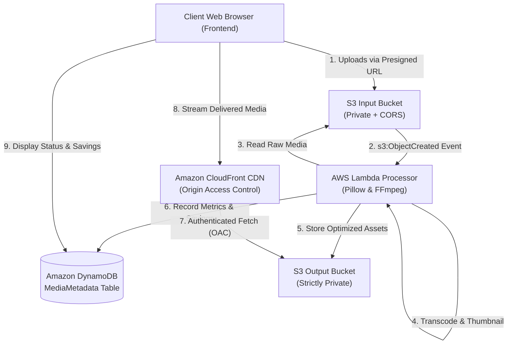

# AWS Serverless Media Transcoder and Thumbnail Pipeline
[](https://aws.amazon.com/)
[](https://aws.amazon.com/s3/)
[](https://aws.amazon.com/lambda/)
[](https://aws.amazon.com/dynamodb/)
[](https://aws.amazon.com/cloudfront/)
[](https://python.org)

An event-driven, production-grade cloud media processing pipeline built on Amazon Web Services (AWS). Automatically optimizes uploaded images and videos, generates high-quality thumbnails, tracks compression telemetry in Amazon DynamoDB, and delivers processed media globally with low latency via Amazon CloudFront using Origin Access Control (OAC).

---

## Architecture Overview



---

## Key Features
- **Dual-Bucket S3 Architecture**: Completely isolates incoming raw uploads from deliverables, physically eliminating Lambda infinite trigger loops.
- **Zero-Public Storage Security**: Both S3 buckets enforce Block Public Access. Content is delivered exclusively through Amazon CloudFront authenticated via **Origin Access Control (OAC)** with AWS SigV4.
- **Direct-to-S3 Presigned Uploads**: The frontend uploads media directly to S3 without passing through backend servers or exposing AWS credentials in client-side code.
- **Intelligent Media Optimization**:
  - **Images**: Resized with aspect ratio preservation, converted to modern WebP format (~75-85% reduction), and generates 200x200 thumbnails.
  - **Videos**: Transcoded with FFmpeg to optimized 720p H.264/AAC, and automatically extracts a video frame thumbnail.
- **Real-Time Telemetry in DynamoDB**: Records original vs optimized byte sizes, processing durations, and savings percentages:
  $$\text{Reduction (\%)} = \frac{\text{Original Size} - \text{Optimized Size}}{\text{Original Size}} \times 100$$
- **1-Click Infrastructure as Code**: Full deployment automated via AWS CloudFormation.

---

## Project Team Structure & Ownership

This project is partitioned into three independent modules with a unified interface contract:

| Team Member | Role | Primary Directory | Core Responsibilities |
| :--- | :--- | :--- | :--- |
| **Person 1** | **Infrastructure & Delivery Lead** | `infrastructure/` | S3 dual buckets, IAM least privilege, CloudFront with OAC, S3 triggers, CloudFormation IaC, and overall system integration. |
| **Person 2** | **Media Processing & Lambda Lead** | `backend/` | Python Lambda handler, Pillow image resizing & WebP compression, FFmpeg video transcoding, thumbnail extraction, and unit tests. |
| **Person 3** | **Website & Metadata Lead** | `frontend/` | Web upload UI, direct S3 presigned upload integration, DynamoDB schema display, before/after previews, and CloudFront media rendering. |

---

## Repository Layout

```text
Aws-serverless-media-hub/
├── infrastructure/                 # Owned by Person 1
│   ├── architecture.md             # Complete architectural documentation & diagrams
│   ├── deployment-notes.md         # Step-by-step CLI & Console deployment runbook
│   ├── interface-contract.md       # Exact team contract (names, paths, schemas)
│   ├── cloudformation-template.yaml# Automated 1-click CloudFormation IaC template
│   ├── cors-config.json            # S3 CORS configuration for frontend uploads
│   ├── s3-output-oac-policy.json   # S3 Output bucket policy for CloudFront OAC
│   ├── generate_presigned_url.py   # Presigned URL generator utility
│   └── deploy.ps1                  # PowerShell deployment automation script
│
├── backend/                        # Owned by Person 2
│   ├── README.md                   # Instructions & interface guide for Person 2
│   └── requirements.txt            # Python dependencies (Pillow, boto3)
│
├── frontend/                       # Owned by Person 3
│   └── README.md                   # Instructions & integration guide for Person 3
│
├── tests/                          # Shared Test Suite
│   └── README.md                   # Benchmark criteria & test cases
│
├── .gitignore                      # Git ignore rules
└── README.md                       # Project master documentation
```

---

## Quickstart for Person 1 (Deploying Infrastructure)

### Option 1: 1-Click AWS CLI Deployment
```bash
aws cloudformation deploy \
  --template-file infrastructure/cloudformation-template.yaml \
  --stack-name media-hub-infrastructure \
  --capabilities CAPABILITY_NAMED_IAM \
  --parameter-overrides ProjectPrefix=media-hub Environment=dev UseExistingLabRole=false
```
*(If using AWS Academy Learner Lab, set `UseExistingLabRole=true`)*

### Option 2: AWS Management Console
1. Open CloudFormation Console -> **Create stack**.
2. Upload `infrastructure/cloudformation-template.yaml`.
3. Provide stack name: `media-hub-infrastructure`.
4. Review and click **Submit**.
5. Once complete, copy outputs from the **Outputs** tab and share with Person 2 and Person 3 as documented in [`infrastructure/interface-contract.md`](infrastructure/interface-contract.md).

For step-by-step manual console instructions, see [`infrastructure/deployment-notes.md`](infrastructure/deployment-notes.md).

---

## License
Academic Project - Distributed for educational and demonstration purposes.
