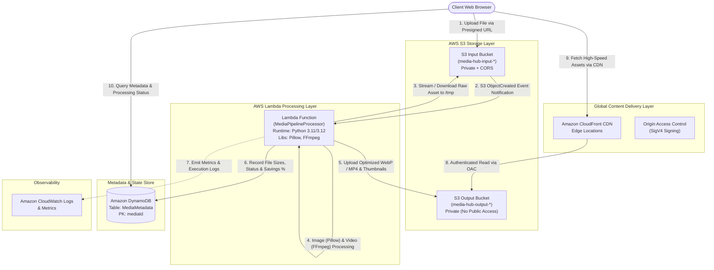
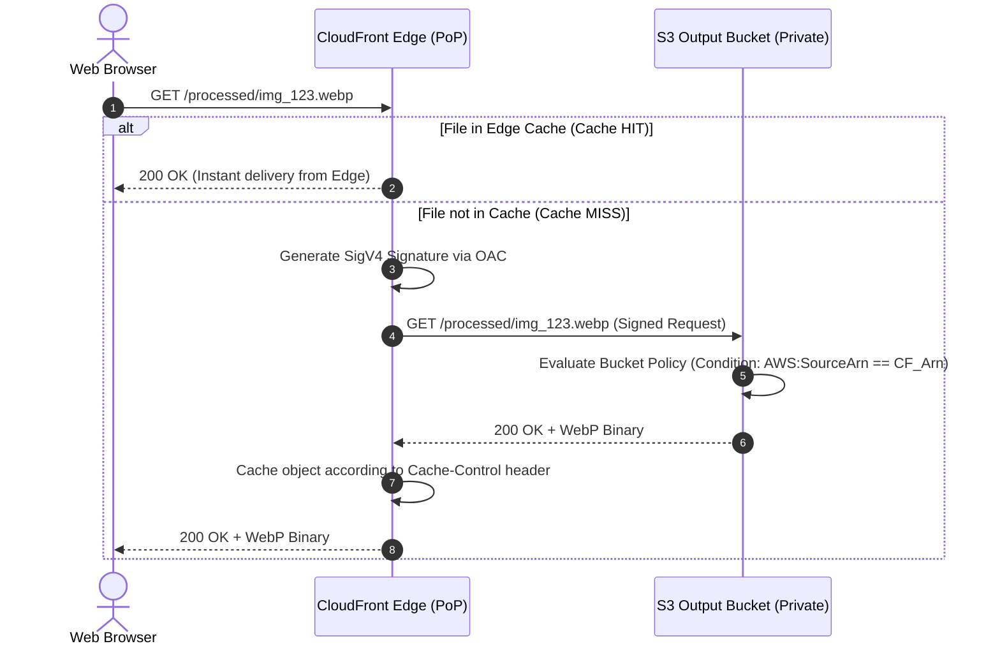
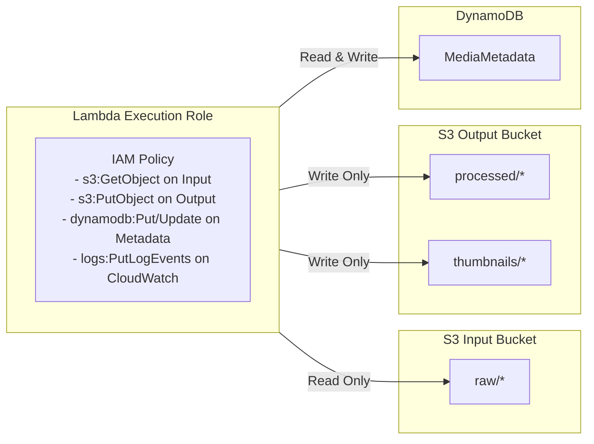

# AWS Serverless Media Transcoder and Thumbnail Pipeline
## System Architecture & Technical Design Document

**Author & Infrastructure Lead**: Person 1  
**Project Repository**: `Aws-serverless-media-hub`  
**Target Platform**: Amazon Web Services (AWS) Serverless

---

## 1. Executive Summary

Modern web applications require high-performance, cost-effective media processing to deliver optimized visual experiences across diverse devices and network conditions. Traditional media processing solutions rely on monolithic virtual machines (e.g., EC2) that remain idle during low traffic periods and struggle to autoscale during traffic spikes, leading to high operational costs and maintenance overhead.

This project implements an **event-driven, serverless media pipeline on AWS**. It decouples media upload, asynchronous processing, metadata persistence, and global delivery:
- **Zero Idle Costs**: Compute executes only when media is uploaded (AWS Lambda pay-per-use).
- **Infinite Scalability**: Handles hundreds of concurrent uploads without provisioning or managing servers.
- **Strict Security Posture**: Storage buckets remain strictly private using **CloudFront Origin Access Control (OAC)** and **S3 Presigned URLs**, ensuring zero exposure of IAM credentials.
- **Quantifiable Storage Savings**: Converts raw images to modern WebP format and transcodes videos to optimized H.264, achieving typical storage reductions of 60%–85%.

---

## 2. End-to-End System Architecture



---

## 3. Component Deep Dive

### 3.1 Amazon S3 Storage Layer (Dual-Bucket Architecture)

The architecture deliberately separates raw incoming assets from processed deliverables into two distinct buckets:

```text
┌─────────────────────────────────┐       ┌─────────────────────────────────┐
│     media-hub-input-<id>        │       │     media-hub-output-<id>       │
│                                 │       │                                 │
│  • Storage for raw media files  │       │  • Storage for optimized media  │
│  • Event trigger ENABLED        │       │  • Event trigger DISABLED       │
│  • CORS enabled for upload      │       │  • Origin for CloudFront CDN    │
│  • Block Public Access: ON      │       │  • Block Public Access: ON      │
└─────────────────────────────────┘       └─────────────────────────────────┘
```

#### Why Two Buckets? (Architectural Criticality)
When an S3 bucket is configured with an `ObjectCreated` event notification triggering a Lambda function, any file write to that bucket fires the event. If the Lambda function were to write its processed output back into the same bucket, it would emit another `ObjectCreated` event, triggering the Lambda function again in an **infinite recursive loop**. This loop would consume account concurrency limits and incur catastrophic AWS charges within minutes.  
By separating the workload into an **Input Bucket** and an **Output Bucket**, the output writes never trigger Lambda events, guaranteeing zero recursive execution by design.

#### S3 Security Controls
- **Block Public Access**: Enabled on both buckets (BlockPublicAcls, IgnorePublicAcls, BlockPublicPolicy, RestrictPublicBuckets all set to `true`).
- **Server-Side Encryption**: Encrypted at rest using SSE-S3 (`AES256`) or AWS KMS.
- **CORS Configuration**: The input bucket allows `PUT` and `POST` requests originating from the web application domain with allowed headers `*` and exposed headers `ETag`.

---

### 3.2 AWS Lambda Compute Layer

AWS Lambda provides serverless compute that executes code in response to S3 events.

- **Trigger Configuration**: Listens for `s3:ObjectCreated:*` events on the input bucket.
- **Resource Sizing**:
  - **Memory**: Allocated 1024 MB to 2048 MB. Lambda proportionally allocates CPU power with memory; 1769 MB provides the equivalent of 1 full vCPU thread, significantly accelerating Pillow compression and FFmpeg video transcoding.
  - **Timeout**: Set to 60 seconds for image processing, expandable to 300 seconds (5 minutes) for video operations.
  - **Ephemeral Storage (`/tmp`)**: Configured to 1024 MB to 2048 MB, allowing Lambda to stage raw input files, process frames, and assemble output files before streaming to S3.
- **Packaging Strategy**:
  - **Pillow**: Packaged as a Lambda Layer compiled for the target Amazon Linux architecture (`x86_64` or `arm64`).
  - **FFmpeg**: Bundled as a static binary inside a Lambda Layer (or containerized image) placed at `/opt/bin/ffmpeg`.

---

### 3.3 Amazon DynamoDB Metadata & State Store

DynamoDB provides single-digit millisecond latency for recording and querying media metadata.

- **Table Design**: Single-table design named `MediaMetadata`.
- **Partition Key**: `mediaId` (String, unique identifier).
- **Billing Mode**: On-Demand (`PAY_PER_REQUEST`), eliminating capacity planning and keeping costs zero when no requests are executed.
- **Attributes Stored**:
  - Original file details (`originalName`, `originalSizeBytes`, `mimeType`, `dimensionsOriginal`).
  - Optimized file details (`optimizedSizeBytes`, `dimensionsOptimized`, `reductionPercent`).
  - Processing telemetry (`status`, `processingDurationMs`, `uploadedAt`, `processedAt`).
  - Delivery paths (`outputKey`, `thumbnailKey`, `outputUrl`, `thumbnailUrl`).

---

### 3.4 Amazon CloudFront & Origin Access Control (OAC)

Amazon CloudFront serves as the global Content Delivery Network (CDN) in front of the private S3 output bucket.



#### Why Origin Access Control (OAC) over Legacy OAI?
1. **Security**: OAC uses **AWS Signature Version 4 (SigV4)** to authenticate requests from CloudFront to S3.
2. **Feature Coverage**: OAC supports all AWS regions, Server-Side Encryption with AWS KMS (SSE-KMS), and dynamic HTTP methods. Legacy Origin Access Identity (OAI) is deprecated by AWS and lacks support for newer AWS regions and KMS integration.
3. **Bucket Policy Enforcement**: The S3 bucket policy grants read permissions exclusively to the CloudFront service principal (`cloudfront.amazonaws.com`) conditionally restricted to the specific CloudFront distribution ARN (`AWS:SourceArn`).

---

## 4. End-to-End Processing Data Flow

```text
[Step 1]  User selects image/video on the website.
[Step 2]  Frontend requests an S3 Presigned Upload URL for the input bucket.
[Step 3]  Frontend executes direct HTTP PUT of the raw file to S3 Input Bucket.
[Step 4]  S3 detects upload and automatically dispatches an ObjectCreated event to AWS Lambda.
[Step 5]  Lambda initializes, writes initial record to DynamoDB (status: "PROCESSING").
[Step 6]  Lambda downloads the file into /tmp, executes compression:
          - Images: Pillow resizes to max 1920px width, saves as WebP (quality=82), generates 200x200 thumbnail.
          - Videos: FFmpeg transcodes to 720p H.264/AAC, extracts frame at 00:00:01 as thumbnail.
[Step 7]  Lambda uploads the optimized media and thumbnail to S3 Output Bucket.
[Step 8]  Lambda updates DynamoDB with final byte sizes, savings percentage, and status: "COMPLETED".
[Step 9]  Frontend polls DynamoDB, detects "COMPLETED", and displays CloudFront delivery links.
```

---

## 5. Security & Least Privilege Architecture

The principle of least privilege is rigorously applied across every IAM policy in the infrastructure:



- The Lambda execution role has **no administrative access**.
- It cannot delete input files.
- It cannot read or modify any other buckets or DynamoDB tables in the AWS account.
- The browser frontend has **no AWS IAM credentials whatsoever**.

---

## 6. Performance & Optimization Formulas

### Space Reduction Metric
$$\text{Reduction Percentage (\%)} = \left( \frac{\text{Original Size} - \text{Optimized Size}}{\text{Original Size}} \right) \times 100$$

### Measured Benchmark Expectations
| Media Type | Original Format | Optimized Format | Typical Original Size | Typical Optimized Size | Average Savings |
| :--- | :--- | :--- | :--- | :--- | :--- |
| High-Res Photo | JPEG / PNG (4032x3024) | WebP (1920x1440) | 4.5 MB | 650 KB | **~85.5%** |
| Screenshot/Graphic | PNG (1920x1080) | WebP (1920x1080) | 2.1 MB | 320 KB | **~84.8%** |
| 1080p Video Clip | MOV / MP4 (30s) | MP4 H.264 / 720p | 38 MB | 7.5 MB | **~80.2%** |

---

## 7. Viva / Examination Defense Guide (For Person 1)

As Infrastructure Lead, you will be evaluated on your understanding of cloud architecture, security, and networking. Below are the key technical questions examiners ask, along with authoritative answers:

### Q1: Why did you choose an event-driven architecture instead of an API-driven polling architecture?
> **Answer**: An event-driven architecture eliminates polling overhead, idle server costs, and latency. S3 notifications invoke Lambda asynchronously within milliseconds of file creation. If we used an EC2 server or container polling an S3 bucket or SQS queue continuously, we would incur 24/7 compute charges and suffer from polling delays. Serverless event-driven design aligns with the cloud principle of paying only for exact execution time.

### Q2: What is the risk of using a single S3 bucket for both input and output?
> **Answer**: In an S3-triggered architecture, writing processed files back into the monitored bucket triggers another `s3:ObjectCreated` event. This causes an **infinite recursive execution loop**, spinning up Lambda instances until the account reaches its concurrency limit, generating thousands of dollars in runaway charges. Using two isolated buckets guarantees physical separation of triggers and outputs.

### Q3: Why is CloudFront with OAC superior to generating S3 Presigned URLs for reading files?
> **Answer**: Presigned URLs allow temporary access to private S3 objects, but every request still hits the origin S3 bucket in a single AWS region, incurring full S3 GET request costs and cross-region latency. CloudFront with OAC caches media at edge locations worldwide. When 100 users request the same image, S3 is queried only once; the remaining 99 requests are served directly from the edge cache with single-digit millisecond latency and lower data transfer costs.

### Q4: How is data protected in transit and at rest?
> **Answer**: 
> - **In Transit**: All traffic between the client and S3, client and CloudFront, and CloudFront and S3 is strictly encrypted using **TLS 1.2 / TLS 1.3**. CloudFront enforces HTTP-to-HTTPS redirection.
> - **At Rest**: Both S3 input and output buckets enforce **Server-Side Encryption (SSE-S3 / AES-256)** by default. DynamoDB tables are encrypted at rest using AWS owned keys.

### Q5: How would this architecture scale if 10,000 files were uploaded simultaneously?
> **Answer**: 
> - S3 natively scales to thousands of PUT requests per second per prefix.
> - Lambda scales horizontally by spinning up concurrent execution environments up to the account concurrency limit (default 1,000 burstable).
> - DynamoDB in On-Demand mode instantly accommodates traffic spikes without throttling.
> - For extreme workloads, we would introduce **Amazon SQS** as a buffer between S3 and Lambda to manage concurrency smoothing and throttle processing to fit downstream limits.
